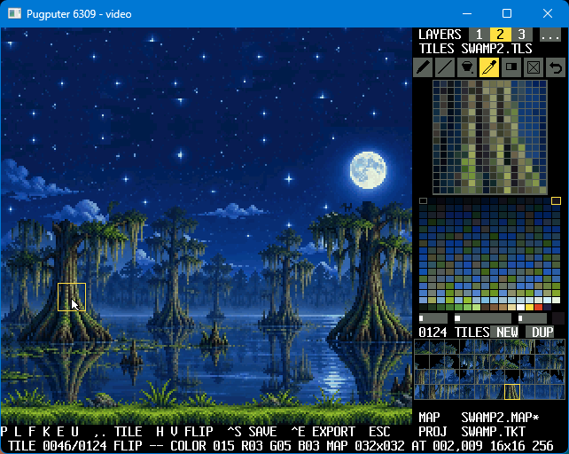
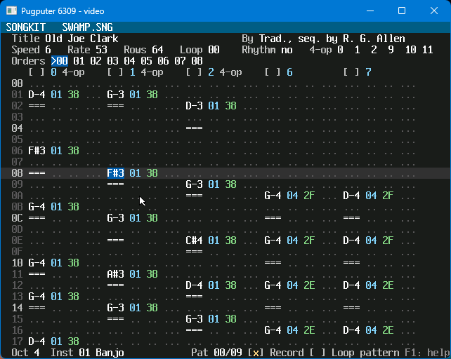

# The game kit

### TILEKIT



### SONGKIT



Tools for making a game's graphics and music on the Pugputer itself, on the
video card's screen and with the card's mouse and keyboard. In the emulator those are the video
window's: click into it and use it, not the terminal. (If the window is closed while one of
these runs, the terminal's keys are given to the card instead, so Esc still works.) What they
make, a game loads straight into the card.

| File | |
|---|---|
| `tilekit.asm` | `TILEKIT.COM`, the tile set and map editor (below); it includes the next nine |
| `tk_map.asm` | its map |
| `tk_layer.asm` | its three layers |
| `tk_ldlg.asm` | the layer's questions (its tile set, kind of tiles, screen, map size) |
| `tk_proj.asm` | its projects (`.TKT`) |
| `tk_src.asm` | its export as assembly source |
| `tk_ini.asm` | reading `TILEKIT.INI` |
| `TILEKIT.INI` | the palettes a new tile set starts with (below); `mkdiskimg` puts it in `/CMD` |
| `tk_draw.asm` | its screen |
| `tk_file.asm` | its files, and the questions it asks |
| `songkit.asm` | `SONGKIT.COM`, the music editor (below); it includes the next five |
| `sk_ui.asm` | its screen (the card's text layer), the mouse and keys, a line of typing |
| `sk_inst.asm` | its instrument page |
| `sk_file.asm` | its files: songs (`.SNG`) and instruments (`.INS`) |
| `sk_pat.asm` | its pattern page: the song's settings, orders and patterns |
| `sk_play.asm` | SONGKIT's player: plays a song on the OPL3, in a game as in the kit's own programs (below) |
| `songplay.asm` | `SONGPLAY.COM`: plays a song file from the shell |
| `tools/sk_fields.py` | makes the instrument page's table of fields in `sk_inst.asm`: where each is, and which is next to it |
| `gk_ui.asm` | what the kit's editors share: the mouse and keys, the editor drawn on sprites ("surfaces") so the card's three layers are all the work's, text on them, the palette and the editor's own colors from it, the mouse pointer, a line of typing |

`compile.sh` (or `compile.bat`) assembles them with lwtools into `build/tilekit.bin`,
`build/songkit.bin` and `build/songplay.bin`, which carry their own program headers;
`mkdiskimg` puts them in `/CMD` as `TILEKIT.COM`, `SONGKIT.COM` and `SONGPLAY.COM`. On the
Pugputer, the release disk's `/ASM/GAMEKIT` has the sources: `ASM -o TILEKIT.COM tilekit.asm`
(or `SONGKIT.COM songkit.asm`, `SONGPLAY.COM songplay.asm`) there makes the same program.

## TILEKIT

```
TILEKIT [file]
```

With a file, it opens it: a project (a name ending in `.TKT`), a map (`.MAP`) with its tile set,
or a tile set (`.TLS`, which is added to a name without an extension). A name that isn't a file
yet is the new set's (or map's). Without one, it asks what to make (Ctrl+N asks again):

- **tiles** 8x8 or 16x16 (T),
- **colors** 16 a tile (4 bits a pixel; which 16 -- one of the palette's 16 rows -- is chosen
  where the tile is placed, so one tile can be drawn in several) or 256 (8 bits a pixel) (D),
- **screen** 320x240 or 640x480 (R): how the map is shown, as the game will show it,
- **the map's width and height** (W, H): 32, 64, 128 or 256 cells each, 16384 cells (32KB) at
  most -- the card's own map sizes,
- **keep the tiles** (K): just a new map for the layer being edited, on its tile set.

That makes three layers, each with a map of that size, all on that tile set (the layer
questions, below, give a layer one of its own). They are the card's own tile layers, so a set
and a map are what a game's tile layer uses as they are. A new set's palette comes from
`TILEKIT.INI` (below).

### Layers

The card has three tile layers, and TILEKIT edits all three -- one at a time, seeing them all,
as a game would show them (the editor itself is drawn on sprites, in front of them). Each layer
has a **map** and a **tile set**: its own, or another layer's (layers can share one -- fewer
tiles to draw, and less video memory). The palette is the card's: every layer's.

The **layer bar**, the panel's top row, shows the layers from the back to the front; the one
being edited is lit up, a hidden one dim, and `...` asks about the one being edited.

| | |
|---|---|
| a layer's button, or 1 2 3 | edit that layer: its tile set comes up in the panel, the tools draw on its map |
| right-click, or Shift+1 2 3 | show or hide it |
| `[` `]` | move the layer being edited back or forward |
| `...`, or Ctrl+L | the layer's questions (below) |

The view is one: every layer scrolls with it, at its own resolution, so they stay lined up.

**The layer's questions** (in the panel; a row's key, or a click on it; Enter does it, Esc
doesn't):

| | |
|---|---|
| S | its tile set: its own, or layer 1's, 2's or 3's |
| T, D | its own set's tiles: 8x8 or 16x16, 16 or 256 colors (another's: as they are) |
| R | its screen: 320x240 or 640x480 |
| W, H | its map's width and height |

What can be kept is: a map made larger or smaller keeps its cells where they were (cut off, or
tile 0 around them); tiles of 16 colors made 256 keep their pixels, each in the palette row the
tile was last used in. Tiles of 256 colors made 16, or of another size, can't be: the tile set
starts again with tiles 0 and 1 blank -- after you say yes. (The other layers on that set change with
it.)

**Room.** Each layer has 48KB of the card's video memory: its own tile set at the start, its
map at the end (the editor has the rest). A tile set can have as many tiles as its layer's map
leaves room for -- with a 64x64 map (8KB), 1280 8x8 tiles of 16 colors (1024 at most, the
card's), 640 of 256 colors, 160 16x16 of 256 colors; with a 256x64 map (32KB), 64 of those.
More tiles, or a larger map, than fit are refused (the layer's questions check first).

### 16 colors: the palette's rows

In a 16-color set a tile's pixels aren't colors but places in a row, 0-15: the palette is 16
rows of 16, and **each cell of the map picks the row** its tile's colors come from (bits 12-15
of the cell). So one tile can be put down in several rows -- a red brick and a blue one. Pixel
0 shows through, whatever row.

Clicking a color picks two things: its place in its row (what the pen draws in a tile) and its
row (what the tile is shown in while it is edited, and what cells are put down with). The mark
left of the palette is the row.

Each tile also remembers the row it was last used in -- drawn on, put on the map, or picked up
from it -- and the tile set shows it in that row, so the other tiles look as they were meant to
while you try this one in another. Selecting a tile picks its row again (the same place in it),
and the rows are saved with the set.

### The screen

- **Left:** the three layers' maps, as the card shows them, the cell under the mouse framed (in
  the layer being edited). A tile being drawn changes wherever it is in the maps as it is drawn.
  (A map smaller than the screen shows over again past its end -- the card's maps wrap around;
  clicks there do nothing.)
- **Right, from the top:** the layer bar; the tile set's file; the tools; the tile magnified, to
  draw in; the palette (16 rows of 16); red, green and blue of the color picked, and that color;
  the set, 10 tiles a row, with NEW and DUP; the map's file; the project's. A `*` after a name:
  changed since saved.
- **Bottom:** the keys (or a message, or a question); the tile, the flips, the color, the map's
  size, the cell under the mouse, the kind of set.

### The tools

The same tools work on the map's cells and on the tile's pixels, whichever the mouse is over:

| | on the map | on the tile |
|---|---|---|
| **pen** (P) | puts the tile down (flipped, in the color's row) | draws in the color |
| **line** (L) | a line of it, from where the button goes down to where it comes up | of the color |
| **fill** (F) | every cell like the one clicked that touches it (not diagonally) | every pixel of its color that touches it |
| **pick** (K or I) | the cell's tile, flips and row become the pen's | the pixel's color becomes the one to draw with |
| **eraser** (E) | tile 0 | color 0 |
| **clear** (button, C) | every cell tile 0 | every pixel 0 |
| **undo** (button, U, Ctrl+Z) | the last change, whichever it was: 16 steps, of the tiles and the map together |

The right button always does what the eraser does. Clear is for whichever was drawn on last.

A blank map is tile 0 everywhere, so tile 0 stays blank (see-through): it is the empty cell, and
the tools won't draw on it. A new set starts with it and tile 1, the one selected, to draw on.
Put tile 0 on a map (or use the eraser) to empty a cell. A tile set from before this that has
pixels in tile 0 keeps them, but they can't be edited.

A large fill takes a while: a 64x64 map, about half a second.

### The mouse

| | |
|---|---|
| a tool button | that tool; the last two are buttons: **clear** and **undo** |
| the map, the magnified tile | the tool, with the left button; the right button rubs out |
| the map, the middle button | drags the map along |
| the wheel, over the map | scrolls it up and down (with Shift, across) a cell a click |
| a color | the color to draw with (in a 16-color set, also its row: the tiles are shown in it, and put on the map with it) |
| red, green, blue | drag along a bar to set the picked color's part of it: the whole screen changes as it goes, as the palette is the card's |
| a tile in the set | that tile; the wheel scrolls the set |
| NEW, DUP | a blank tile, or a copy of this one, at the end of the set |

### The keys

| | |
|---|---|
| P L F K E | the tools |
| C | clear the tile or the map |
| U, Ctrl+Z | undo |
| N, D | a new tile; a copy of this one |
| `,` `.` | the previous or next tile |
| H, V | flip what the pen puts on the map: across, down |
| + (=), - | the next or previous color |
| PgUp, PgDn | the previous or next row of the palette |
| arrows | scroll the map a cell (with Shift, 8); Home: back to its top left |
| 1 2 3, Shift+1 2 3, `[` `]`, Ctrl+L | the layers (above) |
| Ctrl+S | save the project: everything that has changed (below) |
| Ctrl+A | save the project as another name |
| Ctrl+W | save the layer's tile set, then its map, under names asked for (Esc skips one) |
| Ctrl+E | export the project as assembly source (below) |
| Ctrl+O | open a project (`.TKT`), or into the layer being edited a map (`.MAP`, with its set) or a tile set |
| Ctrl+N | a new project (or with K, a new map for the layer being edited) |
| Esc | back to the shell |

A file name is typed at the bottom: Enter takes it, Esc gives up. Opening, making new or
leaving with changes not saved (in any layer) asks first (Y or N).

### Projects

A project is everything at once, under one name: a `.TKT` file naming each layer's tile set and
map files, with how each is shown, the layers' order and the palette. Ctrl+S saves it (asking
its name the first time) and with it every tile set and map that has changed; any that have no
names yet are named after the project -- `GAME.TKT`'s are `GAME1.TLS`, `GAME1.MAP`,
`GAME2.MAP` ... (a set by the number of the layer whose room it is in). Opening it opens them
all. The sets and maps are ordinary `.TLS` and `.MAP` files: they can be opened alone, or named
by other projects. It is text:

```
; TILEKIT project
[PROJECT]
ORDER 1 2 3          the layers, from the back
EDIT 2               the one being edited
[LAYER1]             (and [LAYER2], [LAYER3])
TILES GAME1.TLS      its tile set: layers naming the same file share it
MAP GAME1.MAP        its map
SCREEN 320           320 (x240) or 640 (x480)
SHOW YES             or NO
[PALETTE]
000000 840000 ...    256 colors, RRGGBB
```

### TILEKIT.INI: the palettes a set starts with

A new tile set starts with the palette in `TILEKIT.INI` for its kind -- `[PALETTE8]` for 256
colors, `[PALETTE4]` for 16 -- looked for in the current directory, then in `/CMD`. It is text,
to change with EDIT (or on the PC, in `gamekit/`, before the disk is made):

```
; a comment, to the end of the line
[PALETTE8]
000000 800000 008000 808000 ...    up to 256 colors, RRGGBB in hex, from color 0
[PALETTE4]
000000 1D2B53 7E2553 008751 ...    (a # before one is allowed; spaces, commas, lines between)
```

Colors not given are the card's own (xterm's), and with no `TILEKIT.INI` at all a set starts
with those. The one that comes with TILEKIT has xterm's 256 for 256-color sets, and for
16-color sets rows of 16 made for tiles: PICO-8's 16, grays, twelve hues from dark to light,
earth and skin tones, and the C64's 16. A set's palette, changed or not, is saved with it (and
exported with it).

### The editor's colors

The editor draws itself in colors from the set's palette, which it may not change: the darkest
(its background), the brightest (its text), one about 3/8 of the way between, grays first (the
grid, buttons), and the most yellow (what is picked). When a color is changed they are chosen again,
and the screen redrawn in them.

### The files

A tile set (`.TLS`):

| Offset | |
|---|---|
| 0 | `PTS1` |
| 4 | the tile size (8 or 16), bits a pixel (4 or 8), flags (bit 0: 640x480; bit 1: each tile's row follows the tiles), 0 |
| 8 | how many tiles (2 bytes, high first), then 6 bytes of 0 |
| 16 | the palette: 256 colors, RGB565, 2 bytes each, high byte first -- as the card holds it |
| 528 | the tiles, one after another, as the card holds them: rows of pixels, packed from the high bits (8x8 at 4 bits: 32 bytes a tile) |

| after the tiles | (flags bit 1, 16-color sets) a byte a tile: the row TILEKIT shows it in -- only TILEKIT's; a game can stop reading after the tiles |

At most 1024 tiles (8x8), 512 (16x16, 16 colors) or 256 (16x16, 256 colors): 64KB.

A map (`.MAP`):

| Offset | |
|---|---|
| 0 | `PTM1` |
| 4 | its width, then its height, in cells (2 bytes each, high first): 32, 64, 128 or 256 |
| 8 | its tile set's file name, as it was saved (40 bytes: the name, then 0s) |
| 48 | the cells, a row at a time, 2 bytes each, high first -- the card's map entries: the tile (bits 0-9), flipped across (10), flipped down (11), the palette row (12-15) |

So a game reads the palette into `$040200`, the tiles to where its tile layer's `L_TILEBASE`
points and the cells to its `L_MAPBASE`, as they are, and sets `L_MAP` to the size.

### Exporting as assembly source

Ctrl+E writes the project as assembly source for a game to `INCLUDE` (after `VIDCARD.D`): its
name is asked for (`GAME.ASM` -- the project's name, to start with), and with it go a module for
each tile set in use (`GAME1T.ASM` ...) and each map (`GAME1M.ASM`, `GAME2M.ASM`,
`GAME3M.ASM`), each with labels of its own:

| A set's module (`GAME1T.ASM`) | |
|---|---|
| `GAME1T_TSIZE`, `_BPP`, `_NTILES` | the tile size, bits a pixel, how many tiles |
| `GAME1T_TBYTES` | the tiles' bytes, all told (`_THALF`: half that) |
| `GAME1T_LMODE` | `L_MODE` for a tile layer showing them |
| `GAME1T_TOCARD` | a routine: the palette into the card, and the tiles to A:X in video memory |
| `GAME1T_PAL`, `GAME1T_TILES` | the palette (256 `FDB`s, RGB565); the tiles (`FCB`s, as the card holds them, each after a `; tile n` comment) |

| A map's module (`GAME1M.ASM`) | |
|---|---|
| `GAME1M_W`, `_H` | its size, in cells |
| `GAME1M_LMAP` | `L_MAP` for a tile layer showing it |
| `GAME1M_BYTES` | its cells' bytes |
| `GAME1M_TOCARD` | a routine: the cells to A:X in video memory |
| `GAME1M_CELLS` | the cells, `FDB`s, a row at a time, each after a `; row n` comment |

| The project's (`GAME.ASM`) | |
|---|---|
| `GAME_VBASE` | where they go in video memory: change it to suit -- the rest follow |
| `GAME_T1` ..., `GAME_M1` ..., `GAME_END` | where each set and map goes: one after another from `GAME_VBASE` |
| `GAME_TOCARD` | a routine: every set and map into the card, the palette, and the card's three layers set up as they were in TILEKIT (scrolled to 0, 0) |
| `GAME_LAYERS`, `GAME_SHOW` | the three layers' settings (48 bytes, from the back), and `DC_CTRL`'s bits for the ones shown |
| `GAME_PAL` | the palette |

A game, then:

```
            INCLUDE "VIDCARD.D"
            ...
            JSR  GAME_TOCARD    ; everything in place, the layers on
            ...
            INCLUDE "GAME.ASM"  ; (it INCLUDEs the rest)
```

The data is part of the program then, so it has to fit in its memory beside the code (a
program can be about 44KB): large sets, or large maps, a game reads from the `.TLS` and `.MAP`
files instead, whose layout is above -- the palette, tiles and cells in them are in the card's
form too, ready to be copied through a data port.

### On the card

TILEKIT leaves the card's three tile layers to the project: each layer's 48KB room is from
`$000000`, `$00C000`, `$018000` (a tile set at the start, the map at the end). The editor draws
itself on surfaces (`gk_ui.asm`): bitmaps from `$024000` -- the panel in 4 columns, the status
rows in 8 -- shown by 40 sprites in front of the layers (at most 14 on a line, of the card's
32). Sprite 0 is the pointer, which the card moves with the mouse (`INCTRL` bit 0); sprite 1
frames the cell under it. The sprite table is at `$03CC00`; the text is drawn in the card's own
font, at `$03F000`. The maps' undo steps are copies the card makes in its PSRAM (`$800000`,
32KB each), and a map being resized passes through it too.

### Still to come

Metatiles (8x16, 32x32).

## SONGKIT

SONGKIT is the kit's music, for the OPL3 (YMF262) music chip: a tracker-style editor of
songs and of the chip's instruments, and the player that plays them -- one piece of code,
`sk_play.asm`, in a game and in the kit's own programs alike, so a song plays in a game as it
does in the editor. Here so far: the player, the song file it plays, `SONGPLAY`, and the
editor, with a page for the song's patterns and one for its instruments.

```
SONGPLAY file           (".SNG" is added to a name without an extension)
```

plays a song from the shell: it is read into RAM pages of its own (up to 512KB) and played
from there, timed by the OPL3's Timer 2. A key stops it; at its end, unless it loops, the last
notes have a second to fade.

```
SONGKIT [file]          a song (".SNG" is added to a name without an extension)
```

opens the editor on a song's pattern page -- a new song's (one empty pattern of 64 rows, one
instrument) if no file is named. Tab goes from the pattern page to the instrument page and
back. On either, the keyboard's letters are a piano, Space plays the song (from the order
being edited) or stops it, and a change is heard at once, even while the song plays. The
bottom row is the status line -- the octave, the instrument, the pattern, whether the song is
playing -- where messages and questions come up too (a message until the next key); F1 shows
the help, every key and a few words on how it goes, until a key is pressed.

### The pattern page

At the top, the song's settings: its title and author; its **speed** (ticks a row) and
**rate** (ticks a second); this pattern's **rows**; the **loop** (the order the song goes
back to at its end, or none); **rhythm** mode; and which of the chip's channels are **4-op**
pairs (0 with 3, 1 with 4 ... -- channel 0's pair lit when it is one). Below them the
**orders**, each the pattern it plays (the one being edited lit, the one playing in orange,
the loop's marked `>`); then the pattern that order plays, a row of the grid for each of its
rows and a column for each of the song's tracks, five at a time. A cell reads

```
C-4 01 30 A0F       note, instrument, volume, effect and its parameter (all in hex)
=== .. .. ...       the key let go; dots: nothing there
```

The cursor is on a field of a cell (lit); typing there puts in a note, or a digit, and moves
down a row. The row being played is shown in green as the song plays, and the cursor
follows it: it is kept in the middle of the rows shown, the grid moving on under it and on to
each order's pattern as the song gets there.

The status line has two boxes to tick (with the keys, or a click):

- **Record** (Ctrl+E; off to start with, and as a song is opened): notes and digits go in where the cursor is. As the
  song plays, a note goes in the row playing -- once, however long its key is held -- and
  letting the key go puts in its end (`===`) in the row playing then (let go in the row it
  went in: in the row after, unless a note is there). Off, the piano's keys only play, on the
  cursor's track with the instrument being used, and nothing in the grid can be changed.
- **Loop pattern** (Ctrl+P): the order playing is played again and again, not the next; ticked
  off as it plays, the song goes on from there.

Each track's head has a box too: ticked (`[M]`, with Ctrl+M on the cursor's track, or a
click on the head), the track is muted -- the song goes on without it (its notes still read:
a speed change or a jump in it still done), and the piano's keys can still play on it.

Space plays the song from the start of the order being edited; another order chosen as it
plays (Ctrl+Up, Ctrl+Down, a click, a new or repeated order) is played from its start. A song
with no loop, played in the editor, goes back to its first order at its end, rather than
stopping.

| Keys | |
|---|---|
| arrows | the cursor: a field, a row; up from the first row to the settings (left and right pick one, + and - change it, down goes back) |
| PgUp, PgDn, Home, End | 16 rows up, down; the first row, the last |
| Z-M, Q-P (the piano's keys) | in the note field: that note, with the instrument being used, heard as it goes in |
| 1 | in the note field: the key let go |
| 0-9, A-F | in the other fields: that digit (an effect: 0-9 or A-Z) |
| Delete | the field cleared (a note with its instrument; an effect with its parameter) |
| Insert, Ctrl+Insert | a blank row at the cursor, the rows below down one (the last lost): in this track, in all |
| Shift+Delete, Ctrl+Delete | the row at the cursor out, the rows below up one: in this track, in all |
| Ctrl+Up, Ctrl+Down | the order before, after |
| + (=), - | this order plays the pattern after, before (in the settings: the setting changed) |
| Ctrl+N, Ctrl+D | a new pattern (empty), a copy of this one: played by a new order after this one |
| Ctrl+R, Ctrl+X | this order again (after it); this order out (its pattern stays) |
| Ctrl+Left, Ctrl+Right | the instrument notes go in with: before, after |
| `[` `]` | the octave down, up |
| Enter | on the title, the author: type it again |
| Ctrl+E | Record on, off |
| Ctrl+P | Loop pattern on, off |
| Ctrl+M | the cursor's track muted, or not |
| Tab | the instrument page |
| F1 | the help |
| Space, Backspace, Esc, Ctrl+O, S, A, W | as on the instrument page |

A click picks a cell, an order, or a setting (the title or the author: typed again), or ticks
a box (Record, Loop pattern, a track's head: muted); the wheel over a setting changes it, over the grid moves the cursor. Rhythm mode and the 4-op
pairs change the song's tracks: the song stops first. SONGKIT edits patterns of up to 128
rows (a longer one, from elsewhere, is played and kept as it is).

The song is kept in RAM as its file has it: each change to a pattern is packed into it at
once (what comes after moved along), and the player is told (`SK_RESYNC`), so it goes on
from the same order and row.

The grid is a text layer of its own (the card's layer 0, behind the rest of the screen on
layer 1, seen where that is left clear): the whole pattern, all its 128 rows, scrolled by the
card to the rows shown -- so following the song costs a register written a row, not the
grid drawn again. The rows in view are drawn at once, the others a few at a time as the
editor goes round; and work as long as a new pattern's lets the song's ticks in as it goes,
so the song keeps its time.

### The instrument page

Every setting the chip has for an instrument, on one page, heard as it is changed: the
keyboard's letters are a piano, so a note held while a setting changes changes with it.

- **Top:** the instrument's number (of how many), its name; how many operators (2 or 4), how
  they are connected (FM, one modulating the next, or additive, each heard -- and the four
  ways of 4), the first operator's feedback; a fixed note (a drum) or a transpose, fine tune;
  the outputs (left, right, both); and what the keys play it on, a channel or one of the
  chip's drums (SONGKIT's setting, not the instrument's).
- **The operators,** a column each: attack, decay, sustain level, release, level, multiple
  (of the note's frequency), waveform, key scale level and rate, sustained (held at the
  sustain level while the key is down, or not), vibrato and tremolo. The operators heard --
  the carriers, which the volume turns down -- are headed in orange; the others shape them.
  Attack, decay and release are fastest at 15; level and sustain level loudest at 0.

| Keys | |
|---|---|
| Z S X D C V G B H N J M , L . ; / | a piano: C, C# ... to E an octave up |
| Q 2 W 3 E R 5 T 6 Y 7 U I 9 O 0 P | an octave above those |
| `[` `]` | the octave down, up (0-7; 4 to start with: Z is C-4, middle C) |
| arrows | the setting to change |
| + (=), - | change it (no or yes: the other) |
| Enter | on the name: rename it |
| PgUp, PgDn (or Ctrl+Left, Ctrl+Right) | the instrument before, after |
| Ctrl+N, Ctrl+D | a new instrument; a copy of this one (each after the last) |
| Space | play the song, with its instruments as they are; again: stop |
| Backspace | silence: the song stopped, every note cut off at once (even one that would never fade: a release of 0, sustained) |
| Ctrl+O | open a song, or an instrument (`.INS`) into this one |
| Ctrl+S, Ctrl+A | save the song; save it as another name |
| Ctrl+W | save this instrument as a file of its own (`.INS`) |
| Tab | the pattern page |
| F1 | the help |
| Esc | back to the shell (asked first, with changes not saved) |

A click picks a setting (on the name, renames it); the wheel over one changes it. Up to six
notes sound at once, each on one of the chip's 4-op channels (so 4-op instruments play as they
are); on a drum, one at a time.

An instrument changed while the song plays is heard at once, wherever the song is playing it.

### Songs

A song is a list of **orders**, each naming a **pattern** to play; a pattern is up to 255
**rows** (128 in SONGKIT), and a row has a **cell** for each of the song's 20 **tracks**. A row
lasts *speed* **ticks** (6, to start with), and the song plays *rate* ticks a second (60, to
start with): so 10 rows a second, at first. At the end of its orders a song goes back to its
**loop** order -- or, with none, ends.

The tracks are the OPL3's channels:

| Track | |
|---|---|
| 0-8 | channels 0-8 of the chip's first register array |
| 9-17 | channels 0-8 of its second |
| 18, 19 | only in rhythm mode (below) |

Each array's channels 0 and 3, 1 and 4, 2 and 5 can be a **4-op pair**, as the song says:
then the first is a channel of 4 operators, and the second isn't a track (its cells are left
out). A 4-op channel plays a 4-op instrument as it is, and a 2-op one on its first two
operators, as it would sound on a channel of its own.

In **rhythm mode**, the first array's channels 6, 7 and 8 are the chip's five drums, each a
track of its own:

| Track | Drum | Its operators | Its pitch |
|---|---|---|---|
| 6 | bass drum | both of channel 6's: the instrument's two | channel 6's |
| 7 | snare drum | channel 7's second: the instrument's second | channel 7's |
| 8 | tom-tom | channel 8's first: the instrument's first | channel 8's |
| 18 | cymbal | channel 8's second: the instrument's second | channel 8's (with the tom) |
| 19 | hi-hat | channel 7's first: the instrument's first | channel 7's (with the snare) |

Any instrument with a **fixed note** is a drum on any track too, as General MIDI banks make
them: the note written then only says when it plays.

### A cell

| | |
|---|---|
| **note** | 1-96: C-0 to B-7 (A-4 is 440 Hz); $7F: the key let go (the note fades as its instrument does); 0: none |
| **instrument** | 1-255; 0: none (the track's last). One given: its sound, at full volume |
| **volume** | 1-64: 0-63 (63 loudest); 0: none |
| **effect** | a character, `0`-`9` and `A`-`Z` (0: none), and its parameter, a byte: below |

A note with an instrument (or after one, on that track) starts again: its key let go and
pressed. Volume takes the carriers' levels down from the instrument's, a step (0.75 dB) for
each below 63. An effect lasts its row.

| Effect | |
|---|---|
| `0xy` | arpeggio: the note, x semitones up, y up, a tick each |
| `1xx`, `2xx` | slide up, down xx/32 of a semitone a tick (00: as fast as the last slide) |
| `3xx` | slide to the cell's note, xx/32 of a semitone a tick, the key held (00: the last speed) |
| `4xy` | vibrato: x its speed, y its depth, up to 2 semitones (00: the last) |
| `8xy` | the outputs: x left, y right (`810`, `801`, `811`); both 0: both |
| `Axy` | volume up x, or down y, a tick (00: the last) |
| `Bxx` | after this row, order xx |
| `Cxx` | volume xx (0-3F) |
| `Dxx` | after this row, the next order (or Bxx's), from its row xx |
| `E1x`, `E2x` | up, down x/32 of a semitone, once |
| `ECx` | silent at the row's tick x |
| `EDx` | the cell plays at the row's tick x |
| `Fxx` | 01-1F: ticks a row; 20-FF: ticks a second; 00: the song ends |

### Instruments

An instrument is 32 bytes: the chip's registers for its operators, and how SONGKIT plays it.

| Offset | |
|---|---|
| 0 | flags: bit 0, 4 operators; bit 1, a fixed note (offset 23) |
| 1 | `$C0` for its (first) channel: feedback (bits 1-3), connection (bit 0) |
| 2 | `$C0` for a 4-op pair's second channel: its connection (bit 0) |
| 3-7 | operator 1: its `$20` (tremolo, vibrato, sustain, KSR, multiple), `$40` (KSL, level), `$60` (attack, decay), `$80` (sustain level, release), `$E0` (waveform) |
| 8-12 | operator 2 (in a 2-op channel, the carrier) |
| 13-17, 18-22 | operators 3 and 4 (4-op only) |
| 23 | a fixed note (1-96), or a transpose (semitones, signed) |
| 24 | fine tune, in 32nds of a semitone (signed) |
| 25 | the outputs: bit 4 left, bit 5 right (0: both) |
| 26-31 | 0 (to come) |

The carriers -- the operators heard, which volume turns down -- follow from the connections:
in a 2-op channel the second (connection 0) or both (1); in a 4-op one, by the pair's two
connections: 0 0, the fourth; 0 1, the second and fourth; 1 0, the first and fourth; 1 1, the
first, third and fourth.

### The song file (.SNG)

Its numbers are high byte first.

| Offset | |
|---|---|
| 0 | `PSG1` |
| 4 | flags: bit 0, rhythm mode |
| 5 | the 4-op pairs: register `$104`'s bits (0-2: array 0's 0+3, 1+4, 2+5; 3-5: array 1's) |
| 6 | `$BD`'s bits 7 and 6: deep tremolo, deep vibrato |
| 7 | ticks a second, 32-255 (others: 60) |
| 8 | ticks a row, 1-31 (others: 6) |
| 9, 10, 11 | how many instruments (0-255), patterns (1-255) and orders (1-255) |
| 12 | the loop: the order it goes back to after the last ($FF: none, it ends) |
| 13 | where the instruments' names are (3 bytes, from the file's start; 0: none) |
| 16 | the title: 32 bytes, 0s after it |
| 48 | the author: 32 bytes |
| 80 | the orders: a byte each, a pattern's number |
| then | the pattern table: for each pattern its rows (1-255; 0: 64), then where it is (3 bytes, from the file's start) |
| then | the instruments, 32 bytes each |
| then | the patterns, wherever the table says |
| then | (SONGKIT's) the instruments' names, 16 bytes each, 0s after each -- where offset 13 says |

A player stops before the names: a game can leave them out. SONGKIT writes the patterns
after the instruments, and the names after them.

An instrument's own file (`.INS`) is `PSI1`, its 32 bytes, and its name (16).

A pattern is its rows one after another, and a row its cells that aren't empty, in any order,
each a byte -- bits 0-4 its track, bit 5 a note and an instrument follow, bit 6 a volume
follows, bit 7 an effect and its parameter follow -- and then the bytes it says. `$1F` ends a
row; `$1E n` ends it and the `n` empty rows after it. So an empty row is a byte, and a run of
them two.

### In a game

`sk_play.asm` is `INCLUDE`d after `DEFINES.D`, after the game's code (its variables, about
1.1KB, are at its end). A song is the bytes of its file, in the game's memory or in RAM pages
of its own:

| | |
|---|---|
| `SK_START` | X: the song in memory: plays it from its start (carry set: it isn't a song) |
| `SK_PSTART` | X: a list of the song's pages (a byte each, in order), A: how many, B: the bank (1-3) to see them through: the same, from the pages |
| `SK_POLL` | call it often -- at least every few ms (a main loop waiting for the vertical blank can call it as it waits): when the OPL3's Timer 2 says a tick is due, it plays it |
| `SK_TICK` | one tick, for a game that keeps the time itself |
| `SK_STOP` | the song stopped, its notes let go |
| `SK_OFF` | the chip silent and as it starts: before the game ends, and before `SK_POLL` with no song |
| `SK_MUTE` | (3 bytes; `SK_START` and `SK_PSTART` make them 0) a bit for each track -- bit n of byte n/8 for track n: set, the song doesn't play that track (its cells are still read, so a speed change or a jump in it is still done, but nothing of it goes to the chip) |
| `SK_TOFF` | B: a track: its key let go now (as it is muted) |
| `SK_PLAYING` | (a byte) not 0 while the song plays |
| `SK_TICKS`, `SK_RATE` | Timer 2's ticks so far (2 bytes), and the song's ticks a second |

Timer 2 is the player's, and each tick clears the timers' flags: a game can't count on Timer
1's while a song plays. With the song in pages, their bank is the player's while it plays.

For an editor (SONGKIT uses these), notes played by hand, with a song playing or not:

| | |
|---|---|
| `SK_JSETUP` | A: the 4-op pairs (`$104`'s bits), B: flags (bit 0, rhythm mode): the chip and the tracks set so, with no song |
| `SK_JAM` | B: a track, A: a note (1-96; `$7F` the key let go), E: an instrument (0: the track's own): played now |
| `SK_JREF` | B: a track, E: an instrument: its registers written again, the key as it is -- a held note sounds as the instrument is now |
| `SK_IBASE`, `SK_INUM` | (2 bytes, 1) not 0: the instruments are `SK_INUM` of 32 bytes at `SK_IBASE`, not the song's own (`SK_START` and `SK_PSTART` make it 0) |

And with `SK_EDITOR` defined before the `INCLUDE` (an editor's: a game doesn't carry them):

| | |
|---|---|
| `SK_RESYNC` | the song changed in its memory while it plays (patterns or orders edited, the bytes after them moved along): its header read again, and its place found again -- the same order, the same row |
| `SK_IPG` | (a byte) not 0: `SK_IBASE` is in this RAM page, seen in the bank `SK_IBASE`'s address is in while an instrument is read, that bank's own page put back after (SONGKIT keeps its instruments in a page of their own) |
| `SK_PLOOP` | (a byte) not 0: at the end of the pattern playing (or at a `Bxx`), it is played again from its start (or `Dxx`'s row), not the next order |
| `SK_WRAP` | (a byte) not 0: past the last order, with no loop, back to the first rather than over |

### SONGKIT's next steps

Copying and pasting blocks of a pattern, sound effects on channels kept from the music,
export as VGM and as assembly source, and on the PC, instruments taken from other formats
(and a starter library).
